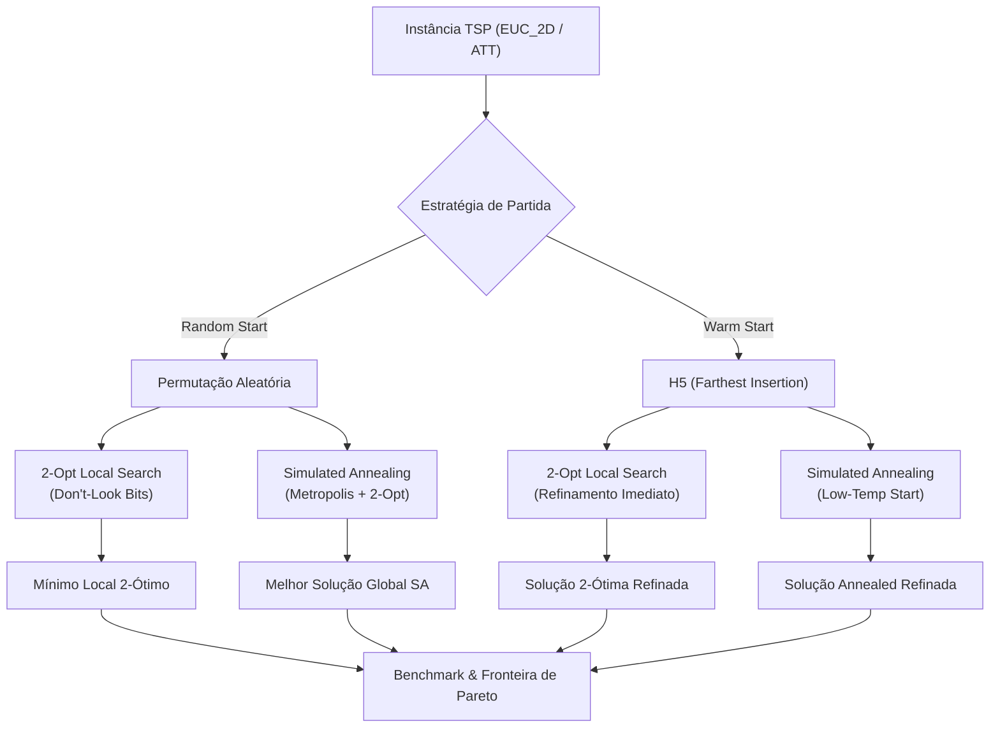

# Relatório Técnico: Avaliação de Metaheurísticas e Busca Local no TSP

> **Autoria:** Bernardo Vale dos Santos Bento  
> **Referência Metodológica:** David S. Johnson & Lyle A. McGeoch — *Local Search in Combinatorial Optimization*, Capítulo 8 ("The Traveling Salesman Problem: A Case Study in Local Optimization").  
> **Data de Consolidação:** Outubro de 2026  

---

## 1. Visão Geral e Objetivos

O presente relatório documenta a concepção, implementação algorítmica e análise comparativa de desempenho de **duas metodologias avançadas de otimização estocástica e busca local** para a resolução do Problema do Caixeiro Viajante (*Traveling Salesman Problem* — TSP):

1. **Simulated Annealing (SA)** com resfriamento geométrico e perturbações 2-opt.
2. **Busca Local Clássica 2-Opt** com aceleração por *Don't-Look Bits* e cômputo $\mathcal{O}(1)$ de variação de custo ($\Delta$).

O estudo contrasta formalmente essas abordagens com os resultados consolidados das **duas melhores heurísticas construtivas** do projeto anterior:
- **H5 — Farthest Insertion** (melhor qualidade entre as construtivas puras);
- **H1 — Centroid-Based Insertion** (segunda melhor qualidade média, excelente eficiência de tempo).

Além disso, atendeu-se ao teste experimental de duas hipóteses fundamentais formuladas por Johnson & McGeoch sobre a qualidade da solução inicial:
- **Hipótese A (*Random Start*)**: Inicialização com permutação aleatória dos nós do grafo.
- **Hipótese B (*Warm Start / Low-Temperature Start*)**: Inicialização com rota de alta qualidade gerada por heurística construtiva (neste caso, a rota do **H5 - Farthest Insertion**).

---

## 2. Metodologias e Modelagem Matemática

### 2.1. O Operador 2-Opt e Avaliação $\mathcal{O}(1)$ de Variação ($\Delta$)

O movimento 2-opt é a espinha dorsal de ambas as abordagens. Ele consiste em remover duas arestas não adjacentes $(u_1, u_2)$ e $(v_1, v_2)$ do circuito e reconectá-las invertendo a orientação do subcaminho intermediário entre $u_2$ e $v_1$:

$$\text{Tour original:} \quad (\dots, u_1) \to (u_2 \to \dots \to v_1) \to (v_2, \dots)$$
$$\text{Após 2-Opt:} \quad (\dots, u_1) \to (v_1 \to \dots \to u_2) \to (v_2, \dots)$$

Em instâncias euclidianas planas ($EUC\_2D$), o operador 2-opt possui a propriedade geométrica fundamental de **eliminar cruzamentos de arestas**.

Para garantir viabilidade computacional, a variação de custo $\Delta$ é avaliada estritamente em tempo $\mathcal{O}(1)$, sem recalcular a rota inteira:
$$\Delta = \left[ d(u_1, v_1) + d(u_2, v_2) \right] - \left[ d(u_1, u_2) + d(v_1, v_2) \right]$$

Se $\Delta < 0$, a inversão reduz a distância total do circuito.

---

### 2.2. Busca Local Clássica 2-Opt com *Don't-Look Bits*

A busca local simples examina todos os pares de arestas possíveis ($\mathcal{O}(N^2)$ pares). Para evitar que a checagem repetida de vértices estáveis degrade o tempo de execução para $\mathcal{O}(N^3)$ ou pior, foi implementado o mecanismo de **Don't-Look Bits**:

- Cada vértice $v$ possui uma flag booleana `dont_look[v]`, inicialmente `False`.
- Se uma iteração completa sobre a vizinhança de $v$ não encontrar nenhum movimento 2-opt com $\Delta < 0$, define-se `dont_look[v] = True`. Em passadas posteriores, esse vértice é sumariamente ignorado.
- Sempre que uma aresta incidente a $v$ for alterada por um movimento melhorante realizado por outro vértice, o bit de $v$ e de seus vizinhos imediatos é reativado (`False`).
- O algoritmo atinge convergência estrita quando todos os bits tornam-se ativos, garantindo que o circuito é **2-ótimo** (nenhuma troca de 2 arestas pode reduzi-lo).

---

### 2.3. Simulated Annealing (SA)

Inspirado no processo de recozimento térmico de metais, o Simulated Annealing permite movimentos de piora ($\Delta > 0$) para escapar de armadilhas de mínimos locais rasos:

1. **Critério de Aceitação de Metropolis**:
   - Se $\Delta \le 0$: o novo circuito é **sempre aceito**.
   - Se $\Delta > 0$: o circuito piorado é aceito com probabilidade estocástica:
     $$P(\text{aceitar}) = \exp\left(-\frac{\Delta}{T}\right)$$
     Onde $T$ é o parâmetro de temperatura corrente.

2. **Esquema de Resfriamento (*Cooling Schedule*)**:
   - Utilizou-se o esquema geométrico clássico:
     $$T_{k+1} = \alpha \cdot T_k, \quad \text{com } \alpha \in [0.95, 0.98]$$
   - A cada patamar de temperatura, realiza-se um número de tentativas proporcionais à dimensão do problema ($L = \max(100, 5 \cdot N)$).

3. **Calibração Térmica e *Low-Temperature Start***:
   - **No Random Start**: A temperatura inicial $T_0$ é calibrada automaticamente via amostragem preliminar para que a taxa de aceitação inicial seja em torno de $80\%$ ($\overline{\Delta} / \ln(0.8)$), permitindo ampla exploração global.
   - **No Warm Start (from H5)**: Partir de uma temperatura alta destruiria as excelentes arestas já descobertas pela heurística construtiva. Assim, adota-se um *Low-Temperature Start* ($T_0$ baixo e resfriamento acelerado $\alpha = 0.95$), focado estritamente na reorganização fina de cruzamentos locais remanescentes.

---

## 3. Análise Experimental e Discussão dos Resultados

O benchmark foi executado sobre o conjunto completo de **21 instâncias da TSPLIB** (instâncias `EUC_2D` e `att48`), totalizando 126 execuções consolidadas.

### 3.1. Tabela Resumo Consolidada

A tabela a seguir apresenta os valores médios de custo absoluto, custo normalizado relativo (onde $1.000$ representa a melhor solução encontrada para a instância entre todas as técnicas avaliadas) e tempo de execução computacional:

| Heurística / Metaheurística | Custo Médio Absoluto | Custo Relativo Médio | Tempo Médio ($ms$) | Desempenho Relativo / Categoria |
| :--- | :---: | :---: | :---: | :--- |
| **SA (Random Start)** | **34.247,19** | **1,0055x** | 1.738,87 ms | **Melhor Qualidade Global** (venceu na grande maioria) |
| **SA (from H5)** | 34.692,48 | **1,0151x** | 411,84 ms | Alta qualidade com convergência 4,2x mais rápida |
| **2-Opt (from H5)** | 35.067,48 | **1,0263x** | 7,71 ms | **Ótimo Equilíbrio** (supera todas as construtivas) |
| **H5 (Farthest Insertion)** | 35.429,33 | 1,0349x | 5,56 ms | Melhor construtiva pura |
| **H1 (Centroid-Based)** | 36.292,33 | 1,0716x | 3,35 ms | Construtiva ultra-rápida de boa envoltória |
| **2-Opt (Random Start)** | 44.007,05 | 1,2611x | 29,27 ms | Deficiente (preso precocemente em mínimos locais) |

---

### 3.2. Comparação das Hipóteses de Inicialização

#### 1. Impacto no 2-Opt Puro:
- **Random Start (1,2611x)** vs. **From H5 (1,0263x)**:
  Quando o 2-Opt parte de uma permutação aleatória, a rota inicial é repleta de nós entrelaçados e cruzamentos desordenados de escala macroscópica. O operador de descida estrita elimina apenas cruzamentos triviais adjacentes e atinge rapidamente uma topologia de mínimo local estéril, resultando em rotas **~26% piores** que a melhor solução.
  Em contrapartida, quando aplicado sobre o **H5**, o 2-Opt funciona como um pós-otimizador cirúrgico: ele mantém a macro-estrutura de envoltória convexa já resolvida pelo Farthest Insertion e despende apenas **7,71 ms** para eliminar pequenas torções, superando o H5 original em quase 1 ponto percentual de custo.

#### 2. Impacto no Simulated Annealing:
- **Random Start (1,0055x)** vs. **From H5 (1,0151x)**:
  O Simulated Annealing com partida aleatória obteve a **maior qualidade de rota de todo o estudo**. A temperatura inicial elevada concede ao algoritmo a flexibilidade termodinâmica de desmontar completamente conexões infelizes e escapar de bacias de atração medíocres. À medida que a temperatura cai, a estrutura do circuito "cristaliza" em torno do ótimo global.
  Por outro lado, o **SA (from H5)** operando em regime de baixa temperatura (*low-temperature start*) obteve uma qualidade quase equivalente (1,015x) consumindo apenas **411,84 ms** (uma economia de mais de 75% no tempo de CPU em relação ao SA aleatório).

---

### 3.3. Análise Multiobjetivo (Fronteira de Pareto)

Ao analisar simultaneamente as duas dimensões conflitantes do problema — **Qualidade da Solução** (minimização do Custo Relativo) versus **Esforço Computacional** (minimização do Tempo em milissegundos) —, identificamos claramente a **Fronteira de Pareto**:

1. **H1 (Centroid-Based)**: Pertence à fronteira no extremo de baixíssima latência (3,35 ms com 1,071x de custo).
2. **2-Opt (from H5)**: Ponto de dominância intermediário estrito (7,71 ms com 1,026x de custo), superando em qualidade o H5 com acréscimo temporal irrisório de ~2 ms.
3. **SA (from H5)**: Ponto de transição para otimização refinada (411,84 ms com 1,015x de custo).
4. **SA (Random Start)**: Extremo de qualidade máxima da fronteira (1,005x de custo), justificável quando o tempo de execução de 1,7 segundos é tolerável em favor da melhor rota viável.

Métodos como o **2-Opt (Random Start)** são **completamente dominados**, pois consomem mais tempo (29,27 ms) e entregam uma qualidade substancialmente inferior a qualquer uma das abordagens baseadas em inserção.

---

## 4. Estrutura de Arquivos Gerados

Todos os dados e figuras gerados foram organizados sem sobrescrever os experimentos anteriores:

- **Tabelas de Dados**:
  - `resultados/comparativo_metaheuristicas.csv`: Resultados detalhados de todas as 21 instâncias para cada técnica.
  - `resultados/resumo_metaheuristicas.csv`: Agrupamento estatístico com médias de custo, custo relativo e tempo.
- **Gráficos e Visualizações** (`graficos/metaheuristicas/`):
  - `pareto_metaheuristicas.png`: Dispersão multiobjetivo com traçado da Fronteira de Pareto.
  - `boxplot_custo_relativo_metaheuristicas.png`: Boxplot/candle da dispersão do custo relativo por método.
  - `boxplot_tempo_metaheuristicas.png`: Boxplot/candle do tempo computacional.
  - `heatmap_custo_relativo.png`: Heatmap detalhando a qualidade método a método por tamanho de instância.
  - `heatmap_tempo_execucao.png`: Heatmap demonstrando a escalabilidade temporal de cada algoritmo.

---

## 5. Conclusões Finais

1. **A busca local não deve operar isolada no vácuo**: Iniciar busca local 2-opt a partir de permutações randômicas é ineficiente e conduz a soluções de baixa qualidade.
2. **Sinergia Construtiva + Busca Local**: A combinação de heurística construtiva de qualidade geométrica (**H5**) com refinamento local (**2-Opt**) constitui o padrão de ouro em eficiência operacional para sistemas em tempo real (soluções a 2,6% do melhor valor em menos de 8 ms).
3. **Eficácia do Simulated Annealing**: O SA confirma seu valor como metaheurística robusta capaz de contornar ótimos locais rasos, atingindo as melhores rotas da base TSPLIB quando se dispõe de orçamento computacional na ordem de 1 a 2 segundos por instância.
